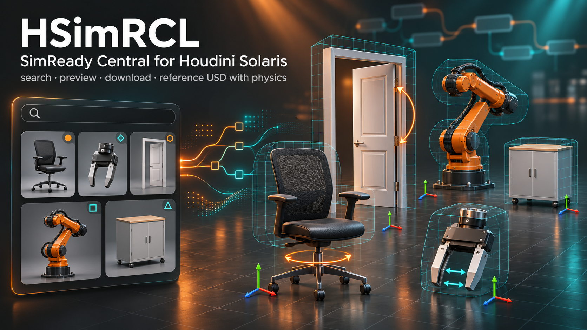

# HSimRCL — SimReady Central for Houdini

[Русская версия](README.ru.md)

Find, download and reference [NVIDIA SimReady Central](https://docs.omniverse.nvidia.com/simready/latest/simready-central.html)
assets in Houdini Solaris. A port of [SimRCL](https://github.com/denwerdan-arch/SimRCL) by Dead_wall (Cinema 4D):
its portable core (catalog search, downloads, local library) is reused; the Houdini side is new.

## Credits

Huge thanks to **Dead_wall**, the author of [SimRCL](https://github.com/denwerdan-arch/SimRCL) — the SimReady Central
browser for Cinema 4D. HSimRCL stands on his work: the catalog search, downloads and local library are his code,
and his notes for porting (`AGENTS.md`) made this Houdini version possible.

- Original plugin for Cinema 4D: https://github.com/denwerdan-arch/SimRCL
- Video overview of how SimRCL works: https://www.youtube.com/watch?v=xmf307dYwqM

> Status: **0.1.0 in development** — nodes of the development version can change between builds; do not rely on
> them in production scenes yet.

## About SimReady

SimReady is NVIDIA's OpenUSD-based standard for simulation-ready 3D assets, introduced for
[NVIDIA Omniverse](https://www.nvidia.com/en-us/omniverse/) at GTC 2022. A SimReady asset carries more than geometry:
mass, friction and collision shapes, articulated joints with limits, semantic labels for AI training and physical
materials for sensor simulation. Omniverse libraries convert and validate assets; Isaac Sim and Isaac Lab are the
reference runtimes. They are used for robotics, digital twins of factories and warehouses, synthetic data and
autonomous-vehicle testing.

In October 2026 NVIDIA opened [SimReady Central](https://docs.omniverse.nvidia.com/simready/latest/simready-central.html) —
a free library of 2000+ SimReady assets on Hugging Face, published by NVIDIA and by manufacturers.

HSimRCL references these assets as USD, so everything Omniverse and Isaac Sim rely on (UsdPhysics joints, rigid
bodies, colliders, semantics, physics variants for PhysX / MuJoCo / Newton) stays in the Solaris stage.

More: [What is SimReady (NVIDIA)](https://www.nvidia.com/en-us/glossary/simready/) ·
[SimReady announcement, GTC 2022](https://developer.nvidia.com/blog/new-cloud-applications-simready-assets-and-tools-for-omniverse-developers-announced-at-gtc) ·
[nvidia/simready-catalog on Hugging Face](https://huggingface.co/datasets/nvidia/simready-catalog)

## What it does

- **SimReady Browser** panel (shelf *HSimRCL → SimReady Browser*, or any pane's tab menu): search with match
  percentages, filters by category, provider, licence, profile, mass, bodies and size, previews with 360° and
  moving-parts clips, Download and **Add to Stage** (or double-click a tile).
- **SimReady Asset** LOP (`hsimrcl::simready_asset::1.0`): search the catalog, download a package, reference its
  root USD under `/simready/<name>`.
- The asset stays a USD reference: physics, joints, colliders, semantics and UsdPreviewSurface materials are kept
  as authored and render in Karma.
- Adds only a Z-up → Y-up rotation and a unit scale as separate xformOps.
- Downloads go to the same folder as SimRCL for Cinema 4D (`~/Documents/SRC by Deadwall/Assets`), so packages are shared.

## Install

1. Copy or clone this folder, e.g. to `~/tools_houdini/HSimRCL`.
2. Put `HSimRCL.json` into a Houdini `packages` folder and set `HSIMRCL` to that path.
3. Restart Houdini. In `/stage` press Tab → **HSimRCL → SimReady Asset**.

Requirements: Houdini 22 (Python 3.13), internet access to `nvidia-simready-central.hf.space` and `huggingface.co`.

## Licences

Code: Apache-2.0 (see `LICENSE`), except the SimRCL core files under MIT (see `NOTICE`).
Every asset has its own licence, mostly CC BY 4.0 — credit the author and note your changes.

HSimRCL is an independent project, not made or endorsed by NVIDIA or SideFX.
